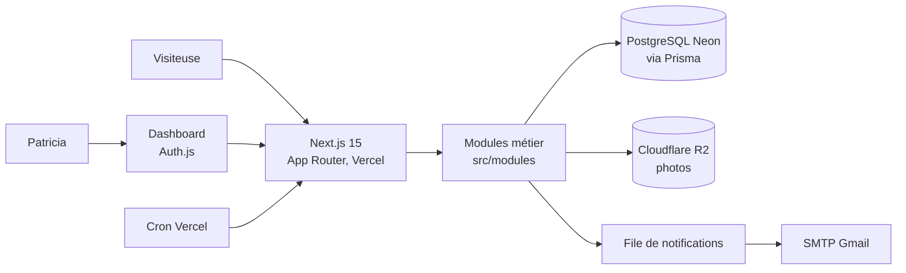
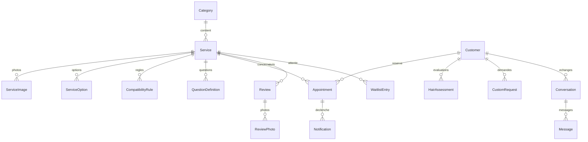

# Hairstyle by Patricia

**Site vitrine, catalogue et réservation en ligne pour une coiffeuse indépendante à Dakar (Sénégal).**
Locs (départ et retwist), nattes collées, vanilles, pour hommes et femmes, sur rendez-vous.

[](https://hairstylebypati.vercel.app)


## Statut

- **En production** : <https://hairstylebypati.vercel.app> (Vercel, déploiement au push sur `main`).
- **Démo** : le site public (catalogue, compatibilité capillaire, réservation) est utilisable librement. Le back-office est réservé à Patricia ; aucune démo publique n'en est proposée.
- **Licence** : code propriétaire, tous droits réservés (voir [Licence](#licence)). Le dépôt est public à titre de référence uniquement.

## Situation, problème, solution

**Situation.** Patricia exerce seule à Dakar. Les rendez-vous passent par messages et appels : créneaux gérés de tête, risque de doubles réservations, questions répétitives sur la compatibilité d'une coiffure avec le cheveu de la cliente (longueur, état, photos).

**Problème.** Une coiffure comme des locs se prépare : une cliente dont le cheveu est inadapté perd du temps et de l'argent, et Patricia perd un créneau. Il faut qualifier avant de réserver, sans bloquer les clientes.

**Solution.** Un site en français, pensé mobile, qui enchaîne :

1. un **catalogue** de prestations (photos, prix en FCFA, durée),
2. un **diagnostic de compatibilité** configurable par prestation,
3. une **réservation en ligne** sans double réservation possible, paiement sur place,
4. un **back-office** où Patricia valide, planifie et échange avec ses clientes.

## Fonctionnalités

**Côté clientes (site public)**

- Accueil, catalogue, fiches détaillées (galerie, prix, durée, coiffures similaires, avis).
- Diagnostic de compatibilité capillaire (questions conditionnelles, photo d'évaluation stockée en privé).
- Réservation en 8 étapes, annulation en ligne par lien sécurisé à durée limitée, liste d'attente, rappel e-mail H-24.
- Demandes personnalisées avec photos de référence, galerie de réalisations, avis avec photos, FAQ, infos pratiques, contact.
- Thème clair/sombre, responsive, accessibilité visée WCAG 2.2 AA.

**Côté Patricia (back-office `/dashboard`)**

- Catalogue (catégories, prestations, options, règles de compatibilité), disponibilités et absences, promotions.
- Réservations (machine à statuts, calendrier jour/semaine/mois/liste), fiches clientes, liste d'attente.
- Messagerie centralisée avec notes internes, notifications, décisions sur évaluations et demandes personnalisées.
- Galerie, avis, statistiques, historique d'audit, paramètres du salon. Guide : [docs/guide-admin.md](docs/guide-admin.md).

## Captures d'écran

Aucune capture n'est versionnée pour le moment : photos, logo et marque appartiennent à Patricia et ne seront publiés qu'avec son accord. Pour voir le rendu, consulter le [site en production](https://hairstylebypati.vercel.app).

## Stack

Versions lues dans `package.json` (plages semver).

| Couche          | Choix                                                                          |
| --------------- | ------------------------------------------------------------------------------ |
| Framework       | Next.js 15.5 (App Router), React 19, TypeScript 5.9 strict                     |
| UI              | Tailwind CSS 4, composants maison, lucide-react ; Playfair Display + Lato      |
| Base de données | PostgreSQL sur Neon, Prisma 6                                                  |
| Auth            | Auth.js (next-auth 5 bêta), identifiants, bcryptjs (coût 12)                   |
| E-mails         | nodemailer (Gmail SMTP) ou mode `console`                                      |
| Fichiers        | Cloudflare R2 (API S3, `@aws-sdk/client-s3`), photos privées par URL présignée |
| Validation      | Zod sur les entrées serveur                                                    |
| Tests           | Vitest 5 (unitaires), Playwright 1.64 (E2E desktop + mobile, axe-core)         |
| Qualité         | ESLint 9, Prettier 3, husky + lint-staged, `npm run ci`                        |
| Hébergement     | Vercel (cron pour les rappels et la purge RGPD)                                |

Node 22 ou plus requis. Choix détaillés : [docs/stack.md](docs/stack.md).

## Architecture



Le code est organisé par domaine dans `src/modules/` (réservations, compatibilité, notifications, avis, etc.) et les pages dans `src/app/`. Détail : [docs/architecture.md](docs/architecture.md).

## Modèle de données

26 modèles et 17 enums Prisma ([prisma/schema.prisma](prisma/schema.prisma)), 15 migrations. Vue simplifiée du coeur :



Prix et durée sont **figés** sur chaque réservation (instantané). Les montants sont stockés en entiers (colonnes `*Cents`, voir [Pays, langue, devise](#pays-langue-devise)).

## Fonctionnement de la réservation

1. La cliente choisit une prestation, répond au diagnostic de compatibilité si la prestation l'exige, puis sélectionne un créneau calculé depuis les disponibilités et les absences.
2. À la validation, le serveur ouvre une transaction et prend un **verrou PostgreSQL** (`pg_advisory_xact_lock`) avant de revérifier le créneau et d'insérer : deux demandes simultanées sur le même créneau ne peuvent pas aboutir toutes les deux. Un **test de concurrence** E2E (`tests/e2e/reservations.spec.ts`) le vérifie.
3. Les règles de compatibilité sont revérifiées côté serveur à la réservation : une évaluation acceptée ne réserve jamais un créneau automatiquement.
4. Une notification e-mail est mise en file (idempotente, reprise sur échec, jamais bloquante pour l'enregistrement).
5. La cliente peut annuler via un lien sécurisé tant que le délai d'annulation (30 minutes par défaut, configurable) n'est pas dépassé. Le paiement se fait sur place.

## Pays, langue, devise

- Interface **en français** uniquement.
- Devise : **FCFA (XOF)**, sans décimales. Les prix sont stockés en **1/100 de FCFA** (colonnes `*Cents`, héritées de la base technique partagée avec un projet frère) et divisés par 100 à l'affichage (`src/lib/catalogue.ts`).
- Fuseau : **Africa/Dakar** ; dates stockées en UTC. Téléphones au format **+221**.

## Tests

Comptage au 2026-10-29 :

- **Vitest** : 50 fichiers, 439 tests, tous verts (`npm test`).
- **Playwright** : 13 fichiers dans `tests/e2e/` (public, réservations dont concurrence, compatibilité, dashboard, notifications, sécurité/RGPD, SEO, responsive et axe-core, thème), projets desktop et mobile. Ils exigent une base de test et des identifiants admin d'essai (`E2E_ADMIN_EMAIL`, `E2E_ADMIN_PASSWORD`) ; ils ne tournent pas dans la CI GitHub.

```bash
npm test                                      # Vitest
npx playwright test --project=desktop --workers=1
npm run ci                                    # typecheck + format + lint + tests + build
```

`npm run ci` enchaîne `tsc --noEmit`, `prettier --check`, `eslint`, `vitest run` et `next build`. Le hook `pre-push` (husky) le lance avant chaque push ; le workflow [.github/workflows/ci.yml](.github/workflows/ci.yml) rejoue la chaîne sur les pull requests vers `main`.

## Démarrage local

```bash
npm install
cp .env.example .env.local   # renseigner les variables (aucun secret dans le dépôt)
npx prisma migrate dev
npm run db:seed              # catégories de base + compte admin
npm run dev                  # http://localhost:3000
```

Avec `EMAIL_MODE="console"`, aucun e-mail réel n'est envoyé. Utiliser une **branche Neon dédiée**, jamais la base de production. Ne jamais lancer `db:seed:demo` en production. Si `next dev` tourne, ne pas lancer build ou push : le cache `.next` serait corrompu (`npm run clean` pour le réparer).

## Déploiement

Vercel, au push sur `main` ; migrations avec `npm run db:deploy`. Les routes cron (rappels H-24, purge des photos privées expirées) sont dans `vercel.json` et protégées par `CRON_SECRET`. Environnements, monitoring et sauvegardes (`scripts/backup-db.mjs`) : [docs/maintenance.md](docs/maintenance.md).

## Difficultés rencontrées

- **Double réservation** : un contrôle suivi d'une insertion laisse passer deux requêtes simultanées ; résolu par un verrou consultatif PostgreSQL dans la transaction et un index d'unicité limité aux réservations actives (migration `slot_unique_active_only`).
- **Devise sans décimales** : le schéma stocke en 1/100 alors que le FCFA n'en a pas ; conversion centralisée.
- **Photos privées et RGPD** : évaluations capillaires stockées en privé, accès par URL présignée, purge automatique à échéance.
- **Notifications fiables** : file idempotente pour qu'un échec SMTP n'annule jamais une réservation.

## Contributions, branches, contributeurs

Chiffres calculés avec git au 2026-10-29 :

- 170 commits sur `main` entre le 17 et le 28 octobre 2026, dont 36 commits de fusion ; 33 pull requests.
- 3 identités git (noms et adresses de commit différents), toutes la même personne : **Daniel Nagoloum Talla**, auteur et mainteneur. Aucun autre contributeur humain.
- **65 commits portent un trailer `Co-Authored-By: Claude`** : une partie du code a été écrite avec l'assistance de Claude (Anthropic), sous la direction et la relecture de l'auteur.
- Conventions : une branche par sujet (`phase/*`, `feat/*`, `fix/*`, `docs/*`), Conventional Commits, PR vers `main`. Voir [CONTRIBUTING.md](CONTRIBUTING.md) et [docs/git.md](docs/git.md).

## Documentation

[Cahier de charge](<Cahier de charge.md>) · [ROADMAP](ROADMAP.md) · [CHANGELOG](CHANGELOG.md) · [DESIGN-RULES](DESIGN-RULES.md) · [acceptation](docs/acceptation.md) · [sécurité](docs/security.md) · [RGPD](docs/rgpd.md) · [performance](docs/performance.md) · [guide admin](docs/guide-admin.md) · [maintenance](docs/maintenance.md)

## Licence

Code propriétaire, © 2026 Daniel Nagoloum Talla, tous droits réservés ([LICENSE](LICENSE)). Aucune utilisation, copie ou redistribution n'est autorisée sans accord écrit ; GitHub l'affiche donc comme « Other ». Le nom « Hairstyle by Patricia », son logo, les photographies et les contenus appartiennent à Patricia et ne sont couverts par aucune cession. Signalement de vulnérabilité : [SECURITY.md](SECURITY.md).
